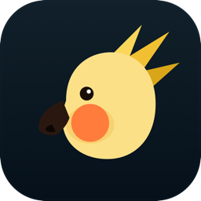

<div align="center">



# ModBeak

A modern, cross-platform Modbus toolbox for industrial automation engineers — a contemporary alternative to ModScan.

</div>

Built with Flutter for **macOS**, **Windows** and **Linux** desktop. Connect to PLCs, VFDs, IO modules and smart meters over TCP or RTU; read and write registers in real time; watch values change; diagnose communication issues at the byte level.

> **Status:** early / testing (v0.4.0). Expect rough edges.

---

## Features

**Transports**
- Modbus TCP and Modbus RTU (serial over USB-to-RS-485 adapter) in one client
- Per-device timeout, min request gap, auto-reconnect, optional request serialisation

**Live polling**
- Multi-device, multi-watch real-time polling on independent intervals
- Per-watch format switching — UInt16 / Int16 / Hex / Binary / UInt32 / Int32 / Float32 (BE/LE) / ASCII / Bool — re-decodes instantly without re-polling
- Per-watch poll statistics (OK / ERR / Avg latency) and a tri-state status LED (green = polling, red = error, gray = paused)

**Writing back**
- Click-to-edit any cell with format-aware validation
- One-tap toggle for Bool / coil cells with optimistic UI
- Bit-level write dialog for 16-bit binary registers (16 checkboxes + live decimal/hex preview)

**Diagnostics**
- **Table** view — dense address/value grid that adapts to the format and pane size
- **Comm** view — per-watch packet log (TX/RX with MBAP parsing, hex dump, automatic request/response pairing)
- **Errors** view — structured CRC / exception / timeout / connection log

**Workspace**
- MDI workspace — every watch is a draggable, resizable, minimisable sub-window
- Cascade / tile rows / tile cols / grid quick-layouts; minimised strip docks paused watches at the bottom
- Save / reload the entire setup (devices, watches, layout) as JSON

**Design**
- Industrial dark + light themes built on layered backgrounds, IBM Plex Sans/Mono and a colour-blind-safe palette (shape + colour double-encoded status)
- Cockatiel mascot 🦜 — the app icon, the brand mark, and the reason it's called ModBeak

See [design/](design/) for the Claude Design handoff bundle the UI was built against.

---

## Install (for testers)

Grab the latest build from the [Releases page](https://github.com/ka1hung/modbeak/releases).

### macOS (Apple Silicon)

1. Download `modbeak-macos-arm64-vX.Y.Z.zip`, unzip to get `ModBeak.app`
2. First launch is blocked by Gatekeeper (the build is unsigned). Either:
   - **System Settings → Privacy & Security**, scroll down, click **Open Anyway**, or
   - Run once: `xattr -cr /path/to/ModBeak.app`

### Windows (x64)

1. Download `modbeak-windows-x64-vX.Y.Z.zip` and unzip the whole folder
2. Double-click `ModBeak.exe` (keep the surrounding files — they're required dlls)
3. SmartScreen may warn you — click **More info → Run anyway**

### Linux (x64)

1. Download `modbeak-linux-x64-vX.Y.Z.tar.gz` and extract
2. Run `./modbeak`
3. For RTU/serial access on most distros: `sudo usermod -aG dialout $USER`, then log out/in

---

## Config file location

ModBeak writes your devices, watches and saved layouts to a single human-readable JSON file. The path is OS-specific — copy it between machines, version-control it, or hand-edit when debugging.

| OS      | Path                                                                 |
|---------|----------------------------------------------------------------------|
| macOS   | `~/Library/Application Support/com.ka1hung.modbeak/config.json`      |
| Windows | `%APPDATA%\com.ka1hung\modbeak\config.json` <br> (i.e. `C:\Users\<you>\AppData\Roaming\com.ka1hung\modbeak\config.json`) |
| Linux   | `~/.local/share/modbeak/config.json` (honours `$XDG_DATA_HOME`)      |

The file is rewritten on every change; closing the app cleanly is not required. You can also bypass it entirely via the **Import** / **Export** buttons in the top toolbar (pick any `.json` you want).

---

## Build from source

Requires [Flutter 3.41.9](https://docs.flutter.dev/release/archive) (stable channel).

```bash
git clone https://github.com/ka1hung/modbeak.git
cd modbeak
flutter pub get

# Run in dev mode
flutter run -d macos          # or: -d windows / -d linux

# Release build
flutter build macos   --release
flutter build windows --release
flutter build linux   --release
```

Build outputs:
- macOS: `build/macos/Build/Products/Release/ModBeak.app`
- Windows: `build\windows\x64\runner\Release\` (entire folder)
- Linux: `build/linux/x64/release/bundle/` (entire folder)

### Platform build deps

- **macOS** — `brew install automake autoconf libtool pkg-config` (libserialport's CocoaPods spec builds from source)
- **Linux** — `ninja-build clang cmake pkg-config libgtk-3-dev liblzma-dev libstdc++-12-dev libserialport-dev`
- **Windows** — nothing beyond a standard Flutter desktop setup

---

## Releasing

Tag-driven CI. Push a `v*` tag and three platforms build in parallel:

```bash
git tag v0.4.0
git push origin v0.4.0
```

[.github/workflows/release.yml](.github/workflows/release.yml) builds on `macos-latest` + `windows-latest` + `ubuntu-latest`, packages each, and attaches all three artifacts to a generated GitHub Release.

---

## Project layout

```
lib/
├── core/
│   ├── modbus/      Wire protocol (TCP/RTU client, framing, CRC, exceptions)
│   ├── codec/       Format codecs (UInt16, Float32 BE/LE, ASCII, …)
│   └── runtime/     Device hub, poll loop, raw-packet capture
├── data/
│   ├── models/      DeviceConfig, WatchSpec, layouts (freezed + JSON)
│   └── persistence/ Config import/export
├── state/           Riverpod providers
└── ui/
    ├── main_window/ Top toolbar, sidebar, device header, dialogs
    ├── watch_window/ MDI workspace + watch pane (Table / Comm / Errors)
    ├── widgets/     Brand mark, status dot, connection indicator
    └── theme/       Tokens, typography, dark/light palettes
```

---

## Tech stack

Flutter • Riverpod • freezed • pluto_grid • go_router • flutter_libserialport
